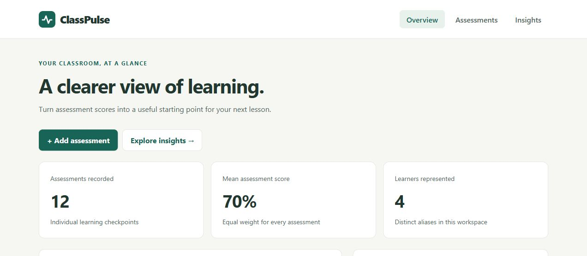

# ClassPulse

A browser-local formative assessment tracker for workshop teachers. Record a quick checkpoint, spot topics worth revisiting, and prepare a check-in conversation from classroom evidence.



## Main journey

1. Open Assessments. Add a learner alias, topic, score, maximum and date, or explicitly load the synthetic demo dataset.
2. Save, search and filter your records. Changes persist on the same browser origin.
3. Open Overview for counts and mean scores; use Insights to review topic patterns and assessments below 60%.
4. Export filtered records as CSV, print the insight report, or reset after confirmation.

## Setup and checks

Node.js 22 or newer. No package installation, secrets, environment variables or account required. No `.env.example` is needed.

```sh
node --test
node scripts/lint.mjs
node scripts/build.mjs
python -m http.server 8000 --bind 127.0.0.1 --directory dist
```

Open http://127.0.0.1:8000. Python 3 is only used for a local static server; any static server can serve `dist/`. Browser modules require HTTP/HTTPS rather than opening the HTML file directly. Keep the same hostname and port to reuse your saved data.

## Design and calculations

Three HTML pages, shared CSS and browser JavaScript modules. No framework or backend is needed for this single-device journey. Pure model and CSV functions use Node's built-in test runner. A simple copy build creates deployable static assets.

The interface uses a light cream background, teal actions, readable labels and compact topic bars. Every score becomes `score / maximum * 100`. Means weight every assessment equally, not every learner or every available point. Topic and learner labels match without case sensitivity; spelling variations remain distinct. Percentages display rounded to a whole number; the review threshold uses the unrounded value. A below-60% score is a fixed demonstration heuristic for teacher review, not a diagnosis or grading rule.

All demo records are synthetic and generated locally. The favicon and visual design are original project assets. No external datasets or image services are used.

## Results and limitations

11 unit tests pass; JavaScript syntax/page-link lint and static build pass. Browser checks cover saving/reloading, invalid input, filters, deletion, reset, demo metrics, CSV controls, print preview and responsive layout. See [verification details](docs/VERIFICATION.md) and [project acceptance criteria](PROJECT_BRIEF.md).

Data stays in localStorage on this origin/browser/device. Use aliases rather than real learner names. Browser cleanup removes data; CSV is an export, and re-import is outside scope. Storage failures are shown without pretending a write succeeded. Unreadable storage is preserved until an explicit reset. Use one tab at a time; concurrent editing is not supported. Existing records are removed and re-entered to correct mistakes. No login, synchronization, multi-class administration, AI, or production student-record security is claimed.

## Planned milestones and delivery

This plan was committed before implementation; each implementation step was checked and committed separately.

1. Working repository setup and static build (`Setup done`).
2. Project brief and acceptance criteria; draft PR opened before app implementation.
3. Responsive three-page shell, navigation, and matching favicon.
4. Validated assessment model and tested summary calculations.
5. Synthetic dataset and resilient browser storage.
6. Assessment entry, validation, and saved-record journey.
7. Searchable records with filtering and confirmed deletion.
8. Dashboard summaries and topic-level learning insights.
9. Safe CSV export, data reset, and print report.
10. Acceptance verification, CI checks, screenshots, and documentation.

Additional focused commits fix narrow-screen overflow and print stylesheet precedence discovered in browser QA. Implementation remains on `feat/classpulse`; default `main` contains setup only pending review. No deployment URL is claimed. Portfolio integration follows a verified merge by Gillian.
